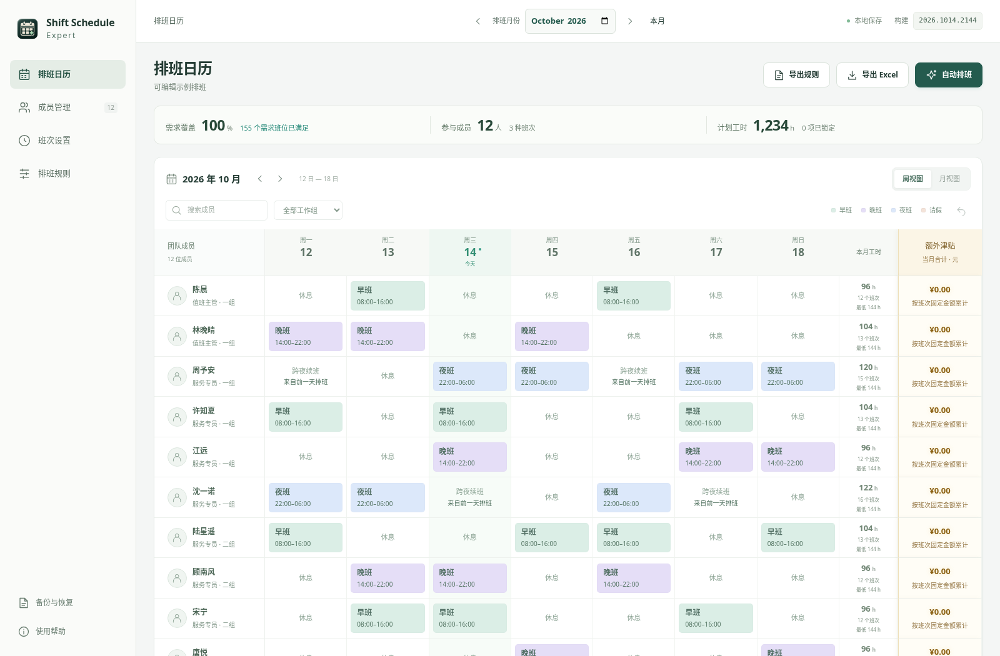

# Shift Schedule Expert · 通用员工排班

按月管理成员、班次与休假，自动排班、统计班次津贴，支持 Excel、CSV 导出和 JSON 备份。桌面版可离线使用。

[下载 Windows / Intel Mac / M 芯片 Mac 版](https://github.com/ecojust/shift-schedule-expert/releases/latest)

*使用 29 位成员、8 种班次的配置，重新生成的独立 10 月示例。*

## 支持的排班规则

| 规则 | 说明 |
| --- | --- |
| 每日人数 | 每班选择「最少人数」或「固定人数」；最少可增派，固定须恰好满足。 |
| 班次资格与请假 | 指定每人可上的班次及请假日期，每人每天最多一个班次。 |
| 周工时 | 设置每周最低和最高工时，按周一至周日自然周核算。 |
| 规则检查 | 切换月份、调整配置或排班、MCP／HTTP 生成后自动后台检查；显示符合规则、具体不符合原因或跨月待核对，检查期间显示加载状态。 |
| 跨月工时 | 月初、月末合并完整自然周；保留相邻月已有排班，未来未知日期临时预排，历史不完整时明确提示。跨夜工时按实际日期拆分。 |
| 休息与连续工作 | 设置最短班间休息时间、最多连续工作天数。 |
| 班次不相连 | 同一成员不能连续两天上指定班次。 |
| 周班次限制 | 指定班次每人每个自然周最多若干次；跨月计入，边界周次数上限不折算。 |
| 同班互斥 | 指定成员不能在同一天上同一个班，可限定适用班次。 |
| 星期权重 | 设置团队各星期的班次数占比；首尾完整自然周合并已知邻月和临时预排的人数，核对整周比例与每日均摊。 |
| 锁定安排 | 保留指定班次或休息，再生成其余安排。 |

月最低工时和月参考工时设置已取消。旧备份、规则文件中的月最低值会自动停用，原有周工时设置、排班和实际月工时统计保留。

生成时只保存目标月份，未安排班次的日期自动作为排班产生的休息；主动请假是独立的不可排班条件，不由空白格产生。应用仅在成功生成并保存后自动记录该月成员的已生成范围（`scheduleCoverage`），无需手动确认休息。相邻月份的临时预排用于验证这一周能否衔接，不会把相邻月份标记为已排班，也不保证相邻整月一定有解。尚未生成的月份及无法确定完整性的旧历史不会把空白自动当作休息。

满足规则后尽量均衡工作量与各班次次数。生成失败或取消时保留原表。

点击顶部日历，在月份选项内查看排班状态，也可切换年份。已有排班按检查结果显示「已排班」「已排班 · 跨月待确认」或「排班有冲突，需重新检查」；没有排班时显示「未排班」。保存成员、班次或规则变更后，已有月份的排班保留并标记「规则已修改，排班已失效」。完整生成的全休月份同样算已排班；跨月待确认表示历史缺失或相邻未来日期尚未生成。

桌面侧边菜单可通过顶部左侧按钮折叠为图标栏，扩大内容区；再次点击即可展开，软件会记住本机的折叠偏好。移动端继续使用抽屉导航。

排班日历支持拖动成员姓名旁的手柄调整人员顺序，成员管理同步采用同一顺序，刷新和切换月份后保留。搜索或按工作组筛选时只重排可见成员，隐藏成员位置保持；人员排序不改变排班记录及其有效状态。

自动排班弹窗实时显示「已获取方案 N 种」。计数来自实际找到的不同可行排班，跨优化阶段重复的方案只计一次；求解在设定时限内继续优化，最后采用优选结果。通过 MCP 或 HTTP 发起的排班也会显示相同进度。

排班日历支持「导出规则」与「导入规则」。之前导出的规则文件可预览并确认恢复成员、班次、设置及所有月份排班，导入后按需重新生成。[规则导入、导出与求解复现](docs/solver-debug.md)

[开发与构建](docs/DESKTOP_BUILD.md) · [工时说明](docs/HOURS.md) · [星期权重](docs/WEEKDAY_WEIGHTS.md) · [验证记录](docs/VERIFICATION.md)

点击桌面版右上角最右侧的**齿轮（设置）**，可分别开启或关闭 MCP 和 HTTP，让外部 AI 读取并按授权修改当前排班数据。两项服务各有连接地址和访问令牌，启停互不影响；MCP 配置可直接复制，无需安装额外工具或运行命令。两项服务共用按数据类别设置的写入权限，默认仅允许修改成员。每张配置卡最多显示一个最近修改状态，MCP／HTTP 修改使用醒目的标签，可查看保存来源与时间，外部配置变更会保留提示。[连接与接口说明](docs/INTEGRATIONS.md)

MCP 的 `generate_schedule` 和 HTTP 的 `POST /api/schedules/generate` 可按已保存的配置调用内置求解器生成排班。月份可选，默认使用软件当前激活月份；成功后保存结果并记录生成时间，失败时保留原排班。使用前需开启「排班结果」权限。
